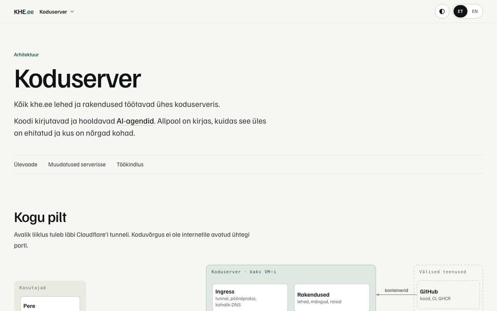

# khe-ui

[](https://github.com/khelias/khe-ui/actions/workflows/ci.yml)
[](https://www.npmjs.com/package/@khelias/ui)

The shared site header and site footer of the KHE apps, published as
[`@khelias/ui`](https://www.npmjs.com/package/@khelias/ui) for the apps that
build them in. The header has the KHE.ee mark, a rooms menu naming the room
you are in and listing the others, the app's name after a slash, an optional
light/dark theme toggle and an ET/EN language switcher; the footer has the
page links with the GitHub and LinkedIn marks and a line of text. Both are
live on [khe.ee](https://khe.ee) and its apps.

[](https://khe.ee/architecture/)

## How it works

[khe.ee](https://khe.ee), [KHE Games](https://games.khe.ee) and the other
KHE apps are separate repos on separate stacks that share one family
chrome
([estate ADR-035](https://github.com/khelias/khe-architecture/blob/main/decisions/035-family-shell-and-design-check-with-its-exceptions.md)).
A header or footer built in each app drifts, and a fix reaches one copy at a
time, so the anatomy, sizes and states live here, and each app sets the
family colours through CSS custom properties and moves to a new release
when it chooses
([estate ADR-014](https://github.com/khelias/khe-architecture/blob/main/decisions/014-shared-ui-packages.md)).

Each part comes as an HTML-string renderer, for a page built without a
framework, and as a React component, and both write the same markup. The
package also carries the pre-paint scripts of the theme toggle and the
product view, and `khe-design-lint`, the family design check. How an app
uses each is in [docs/usage.md](docs/usage.md).

## Run it

In an app:

```sh
npm install @khelias/ui
```

To work on the package:

```sh
npm ci
npm run check
```

Commands, the markup contract and the release procedure are in
[AGENTS.md](AGENTS.md).

## Where it runs

A version tag publishes the package to npm through the release workflow;
each release and its notes are on
[GitHub Releases](https://github.com/khelias/khe-ui/releases). Every app pins
a version and moves to a new one in its own commit.

## More

- [docs/usage.md](docs/usage.md) - rendering the header and footer, the
  theme toggle, the demo line, theming and the design check
- [docs/decisions/](docs/decisions/) - the package's design decisions
- [AGENTS.md](AGENTS.md) - commands, layout, the markup contract, tokens and
  the release procedure

## Licence

MIT, see [LICENSE](LICENSE).
